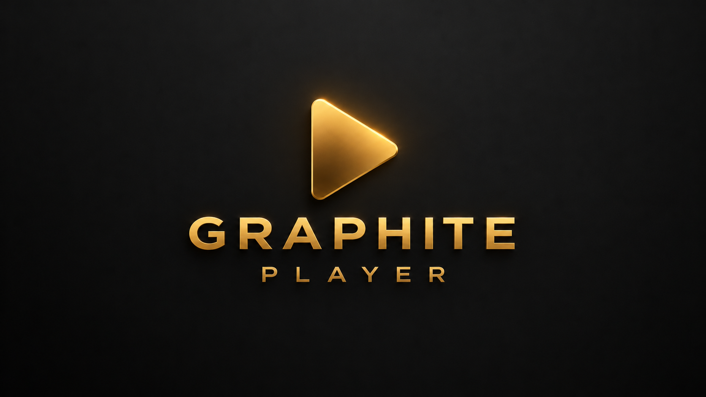

# 🎬 Graphite Player



Лёгкий и быстрый видеоплеер для Android TV с минималистичным графитово-золотым интерфейсом.

За основу взять [Just Player](https://github.com/moneytoo/Player) — быстродействие, простота и низкое потребление ресурсов — и добавлена полноценная TV-навигация.

## ✨ Возможности

- 📺 удобное меню для Android TV;
- 🎮 управление стрелками и центральной кнопкой пульта;
- 💾 внутренняя память и USB в боковом меню;
- 📁 навигация по папкам;
- 🎞️ крупные карточки папок и видео;
- ▶️ быстрые заглушки без долгой генерации кадров;
- 📊 сохранение позиции и прогресс просмотра;
- ✅ отметка завершённых видео после 95%;
- 🎨 графитово-золотая айдентика Graphite Player.

## 🛠️ Сборка

Требуется JDK 17+ и Android SDK:

```powershell
$env:JAVA_HOME="C:\Program Files\Android\Android Studio\jbr"
$env:Path="$env:JAVA_HOME\bin;$env:Path"
.\gradlew.bat assembleLatestUniversalRelease --no-daemon
```

## 📦 Установка

```powershell
1. Откройте страницу **Releases** на GitHub.
2. Скачайте файл `Graphite.Player.v0.219.apk`.
3. Передайте APK на телевизор через USB, облако или файловый менеджер.
4. Разрешите установку из неизвестных источников для используемого файлового менеджера.
5. Откройте APK и подтвердите установку.
